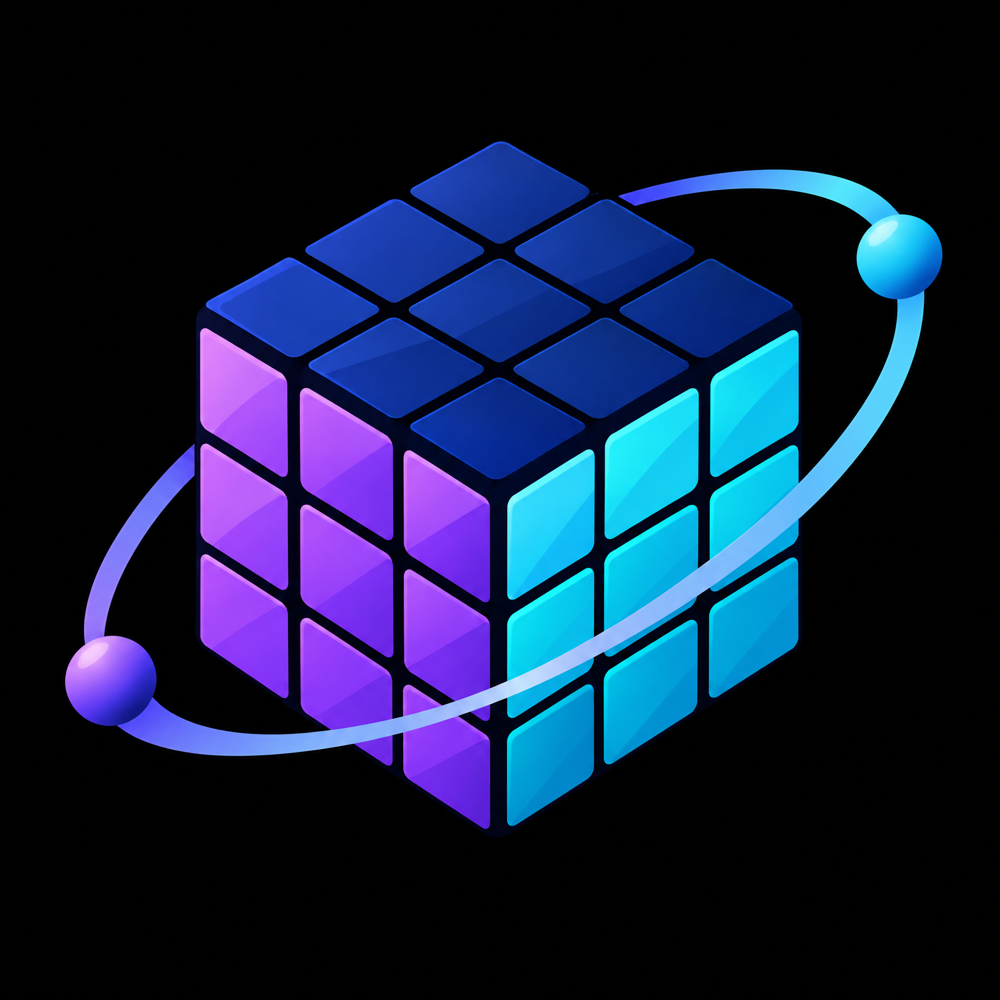
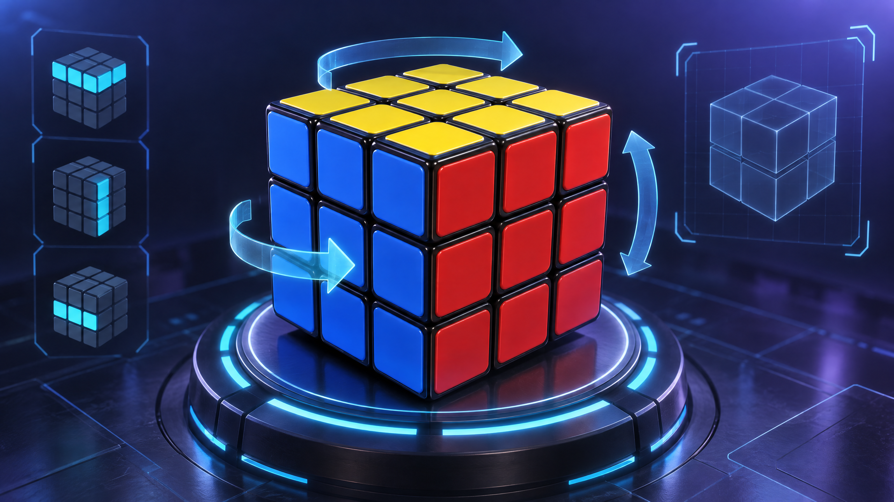
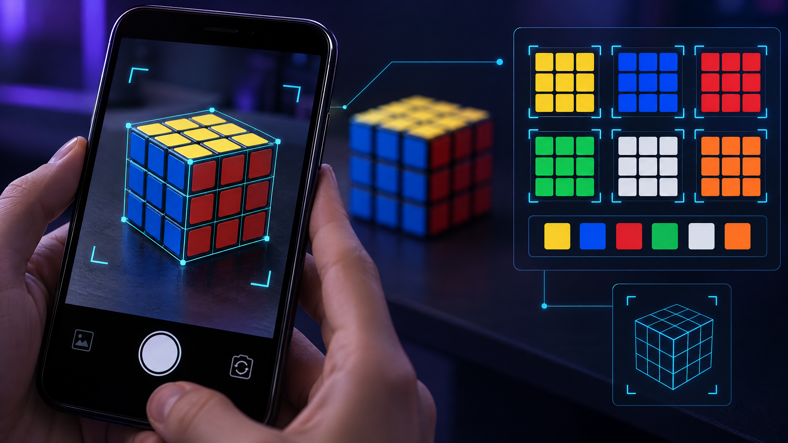
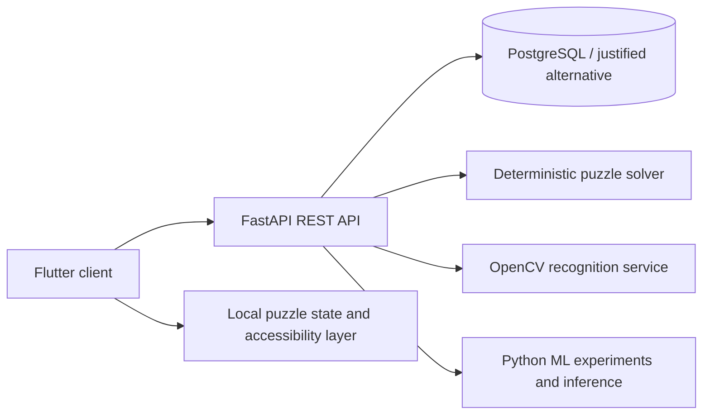

<div align="center">
  
  <h1>PuzzleVerse-3D</h1>
  <p><strong>An extensible 3D puzzle platform with machine learning-assisted play.</strong></p>
  <p>
    
    
    
    
    
  </p>
</div>


> **Status:** The repository contains the project foundation and an initial Android Flutter prototype (v0.1.0). The prototype supports local Rubik's Cube face turns, view rotation, shuffle, undo, and reset. Camera scanning, automatic solving, persistence, backend integration, player recommendations, and additional games are not implemented yet. Concept illustrations remain non-functional mockups.

## Why PuzzleVerse-3D?

Many puzzle applications provide either a flat game board or a standalone solver. PuzzleVerse-3D proposes a modular platform that combines an interactive 3D experience with reproducible puzzle algorithms and carefully scoped machine learning experiments. The initial game is Rubik's Cube, with Number Puzzle and additional games designed as future modules.

## Proposed solution

PuzzleVerse-3D separates the user experience, backend services, deterministic puzzle solving, computer vision, and player-intelligence experiments. This makes it possible to ship a testable MVP without treating every research idea as a finished feature.

### Planned core capabilities

- Interactive Rubik's Cube experience, initially as a frontend proof of concept.
- Manual cube color configuration for reliable baseline input.
- Deterministic solver integration; solver logic is not described as machine learning.
- Optional camera-assisted sticker-color recognition using OpenCV and a measured evaluation set.
- Player-session telemetry for skill analysis and difficulty recommendations.
- A modular game boundary for Number Puzzle and future puzzle experiences.



## Machine learning directions

**Player intelligence** will model observable session features such as completion time, move count, hints, errors, and progression. Candidate baselines include interpretable regression or classification models before more complex approaches are considered.

**Computer vision** will investigate cube-face detection, sticker sampling, color classification, illumination variation, and configuration validation. Lighting and camera variation are known challenges in color constancy research; therefore, no recognition accuracy is claimed before a dataset and evaluation protocol exist.




## Architecture at a glance



The detailed architecture, data flow, and decision record are in [`docs/SYSTEM-ARCHITECTURE.md`](docs/SYSTEM-ARCHITECTURE.md), [`docs/diagrams/`](docs/diagrams/), and [`docs/DECISIONS.md`](docs/DECISIONS.md).

## Technology direction

Flutter is now used for the Android interaction proof of concept. Its cube is rendered with a custom 3D-style canvas painter; the final rendering-engine decision remains open pending performance and platform comparison. Python/FastAPI, OpenCV, Python ML tooling, REST, GitHub Actions, and Git/GitHub remain planned components. See [`docs/TECHNOLOGY-COMPARISON.md`](docs/TECHNOLOGY-COMPARISON.md).


## MVP boundary

The first MVP increment is a local Rubik's Cube practice prototype. A store-ready MVP still needs validated cube configuration, a deterministic solver, persistence, an evaluated ML baseline, a Number Puzzle vertical slice, real-device testing, and a production signing/release process. The current prototype must not be represented as a store-ready solver.

## Repository map

```text
frontend/app/      Flutter Android prototype and tests
backend/           FastAPI service boundary and tests
machine-learning/  datasets, experiments, and reproducible ML code
assets/            conceptual visuals and attribution records
docs/              requirements, architecture, research, and process
.github/           CI, issue forms, PR guidance, and dependency updates
tests/             cross-component and documentation checks
```

## Getting started

Run the Flutter prototype and its tests:

```bash
cd frontend/app
flutter pub get
flutter test
flutter run
```

The repository also provides a runnable FastAPI health endpoint and Python test baselines. Android CI builds a debug APK for testing; it is not signed for store distribution.

```bash
cd backend
python -m venv .venv
source .venv/bin/activate
pip install -r requirements.txt
uvicorn app.main:app --reload
# visit http://127.0.0.1:8000/health
pytest
```

For the ML boundary:

```bash
cd machine-learning
python -m venv .venv
source .venv/bin/activate
pip install -r requirements.txt
pytest
```

## Roadmap

1. Repository and requirements baseline.
2. Architecture and 3D proof of concept.
3. Core frontend and backend.
4. Rubik's Cube interaction.
5. Solver integration.
6. One measurable ML experiment.
7. Camera-assisted recognition feasibility study.
8. Testing and evaluation.
9. Final documentation and presentation.

No invented deadlines are assigned. See [`docs/DEVELOPMENT-ROADMAP.md`](docs/DEVELOPMENT-ROADMAP.md) and [`docs/TASK-BACKLOG.md`](docs/TASK-BACKLOG.md).

## Team

- **Abdulrahman Al-Zubaidi** — project management, machine learning and AI, coordination, technical direction.
- **Abdulrahman Yousef Al-Habashi** — backend, API, database and server architecture.
- **Mohammed Sharaf Al-Din** — frontend, UI/UX and interactive experience.

No GitHub usernames, emails, or collaborator permissions are assumed here. Repository administration and invitations remain manual actions for the project owner.

## Documentation

- [Project overview and vision](docs/PROJECT-OVERVIEW.md)
- [SRS](docs/SRS.md)
- [System architecture](docs/SYSTEM-ARCHITECTURE.md)
- [API contract](docs/API-CONTRACT.md)
- [Database design](docs/DATABASE-DESIGN.md)
- [ML plan](docs/MACHINE-LEARNING-PLAN.md)
- [Computer vision plan](docs/COMPUTER-VISION-PLAN.md)
- [Solver and algorithms](docs/ALGORITHMS-AND-SOLVER.md)
- [Testing strategy](docs/TESTING-STRATEGY.md)
- [Security and privacy](docs/SECURITY-AND-PRIVACY.md)
- [References](docs/REFERENCES.md)
- [Repository setup report](docs/REPOSITORY-SETUP-REPORT.md)

## Contributing

Use an issue, create a branch such as `feature/feature-name`, run the relevant checks, and open a pull request. Read [`CONTRIBUTING.md`](CONTRIBUTING.md) and [`docs/GITHUB-WORKFLOW.md`](docs/GITHUB-WORKFLOW.md) before contributing.

## Current limitations

The codebase is still an early prototype, not a completed application. There is no trained model, benchmark, production database, camera recognizer, cube solver, or finalized 3D engine in this version. The Android debug APK is for testing only. Any future research result must include its dataset, method, metrics, and reproducibility notes.

## References

The academic and technical sources used to frame this foundation are recorded in [`docs/REFERENCES.md`](docs/REFERENCES.md), including Korf's Rubik's Cube search work, official Flutter/FastAPI/OpenCV documentation, and color-constancy research.

## License and academic use

No project license has been selected by the team. Until a license is added, treat the repository as an academic collaboration and do not assume reuse rights beyond the terms of third-party assets documented in [`assets/media-sources.md`](assets/media-sources.md).
