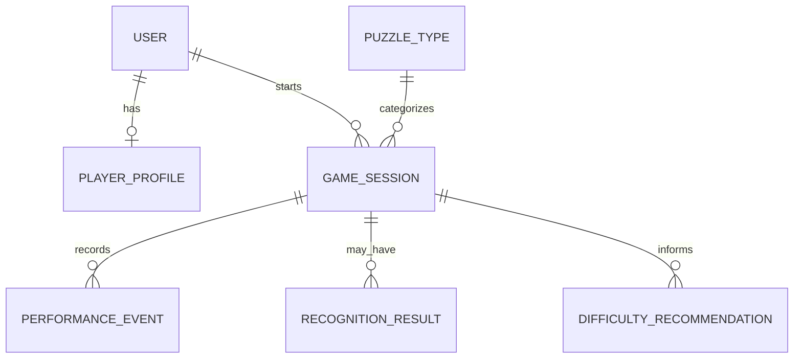

# Database design (proposed)

This schema is a proposal for backend review, not a finalized implementation.

Candidate tables are `users`, `player_profiles`, `puzzle_types`, `game_sessions`, `performance_events`, `recognition_results`, and `difficulty_recommendations`. Store the minimum data needed for progress and evaluation. Retention, deletion, indexing, and anonymization decisions require backend and privacy review.
