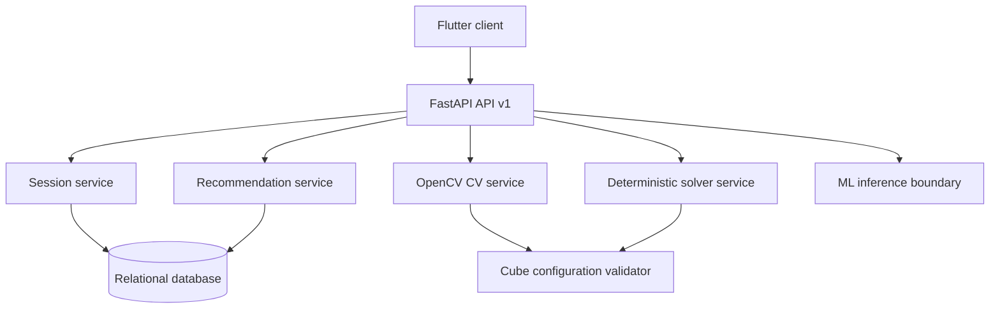

# System architecture

The proposed architecture uses a Flutter client, a FastAPI REST service, a relational persistence layer, deterministic puzzle services, an OpenCV computer-vision boundary, and Python ML experiments. The API is the integration boundary; the client should remain usable for local puzzle state when network access is unavailable.

All ML and CV components are proposed boundaries. They must be implemented and measured before they are described as operational.
